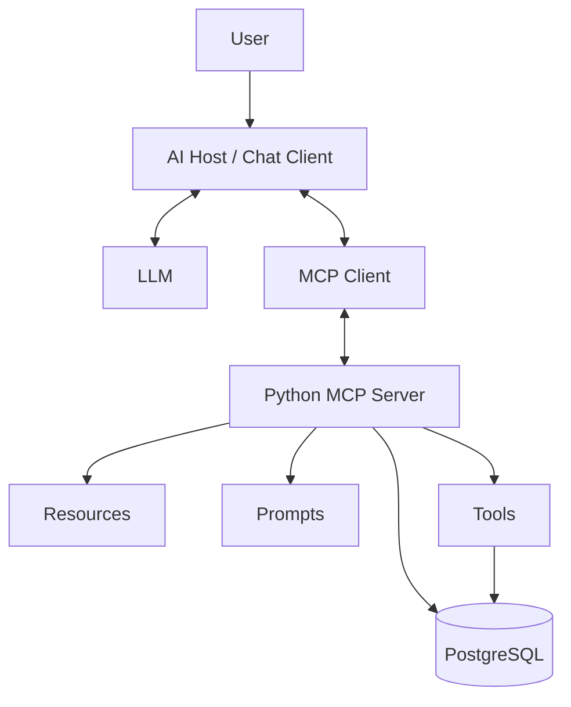

git 

# Weather & Disaster Intelligence MCP Server

An educational Model Context Protocol (MCP) project that connects an AI
client to district-level weather forecasts and normalized disaster
alerts stored in PostgreSQL.

The project demonstrates how an MCP server can expose **tools**,
**resources**, and **prompts** so compatible AI applications can
discover and use weather-data capabilities.

> **Important:** This server reports data available from its configured
> sources. It does not independently predict weather. Forecasts beyond
> the stored forecast horizon require a separate forecast provider or a
> validated prediction model.

## Features

### MCP tools

---

  Tool                                                                                            Purpose

---

  `get_district_forecast(district, limit=7)`                                                      Retrieves available forecast rows
                                                                                                  for a district.

  `get_high_risk_districts(limit=100)`                                                            Lists districts with elevated
                                                                                                  severity according to the
                                                                                                  configured severity fields.

  `get_disaster_alerts(disaster_type="", district="", state_ut="", active_only=True, limit=50)`   Filters normalized NDMA disaster
                                                                                                  alerts.

`get_district_disaster_summary(district)`                                                       Combines a district's available
                                                                                                  forecast and relevant disaster
                                                                                                  alerts.
---------------------------------------------------------------------------------------------------------

### MCP resource

---

  URI                                 Purpose

---

  `weather://database/catalog`        Describes the forecast and
                                      disaster-alert datasets, selected
                                      fields, and known data limitations.

---

### MCP prompt

---

  Prompt                                        Purpose

---

  `analyze_weather_risk(district, focus=...)`   Reusable instructions for analyzing
                                                forecast conditions and active
                                                disaster alerts.

---

The prompt is a reusable instruction template; it does not itself query
PostgreSQL. The AI host/client retrieves it when appropriate. The LLM
may then request a tool call, and the MCP client mediates that call to
the server.

## Architecture



Typical request flow:

1. The user asks a weather or disaster-risk question.
2. The host sends the question and relevant context to the LLM.
3. The LLM identifies the information needed and may propose an MCP
   tool call.
4. The host/client invokes the selected tool through MCP.
5. The server validates the arguments and queries PostgreSQL.
6. The tool result returns to the host and is provided to the LLM.
7. The LLM summarizes the returned evidence, including missing data and
   limitations.

## Technology stack

- Python 3.11
- MCP Python SDK
- PostgreSQL
- `psycopg` for database access
- `python-dotenv` for local environment configuration
- MCP Inspector and a compatible AI client for development and testing

> MCP SDK APIs can vary by release. This project currently uses the
> `MCPServer` API. Check your installed SDK version before copying
> examples that use a different API such as `FastMCP`.

## Prerequisites

- Python 3.11
- Access to a PostgreSQL database containing the required tables
- An MCP-compatible client, such as MCP Inspector or a configured AI
  development environment

## Setup

### 1. Clone the repository

```bash
git clone <YOUR_GITHUB_REPOSITORY_URL>
cd <YOUR_PROJECT_DIRECTORY>
```

Replace the placeholders with your repository URL and directory name.

### 2. Create and activate a virtual environment

**Windows PowerShell:**

```powershell
py -3.11 -m venv py-env
.\py-env\Scripts\Activate.ps1
python -m pip install --upgrade pip
```

If PowerShell blocks activation, you can invoke the virtual
environment's Python directly:

```powershell
.\py-env\Scripts\python.exe -m pip install --upgrade pip
```

### 3. Install dependencies

If `requirements.txt` exists:

```bash
pip install -r requirements.txt
```

Otherwise, install the dependencies used by this project:

```bash
pip install mcp "psycopg[binary]" python-dotenv
pip freeze > requirements.txt
```

Use the versions tested with your project and commit `requirements.txt`
so the environment can be reproduced.

### 4. Configure environment variables

Create a local `.env` file in the project root:

```dotenv
DB_HOST=localhost
DB_PORT=5432
DB_NAME=your_database
DB_USER=your_read_only_user
DB_PASSWORD=your_password
```

Update these values for your environment. **Never commit `.env` or
publish database credentials.** Use a dedicated database role with only
the permissions required by the server.

Add a `.gitignore` file:

```gitignore
.env
py-env/
.venv/
__pycache__/
*.py[cod]
.pytest_cache/
```

Ensure your database configuration code reads the variable names used in
your `.env` file.

## Database requirements

The server expects the configured PostgreSQL database to contain the
following datasets, or equivalent views with compatible columns.

### Forecast dataset

`weatherdata.district_wise_7dayfc_severity`

Typical fields include:

- `days`, `date`, `district`
- `temp_min`, `temp_max`
- `rain_percent`, `rain_precip`
- `wind`, `visibility`, `humidity`
- Severity fields such as `temp_max_severity`, `temp_min_severity`,
  `rain_severity`, `wind_severity`, and `visibility_severity`
- `condition_text`

### Disaster-alert dataset

`weatherdata.disaster_ndma`

Typical fields include:

- `identifier`, `district`, `state_ut`, `indus_circle`
- `severity`, `severity_level`, `severity_color`
- `effective_start_time`, `effective_end_time`
- `disaster_type`, `area_description`, `warning_message`
- `alert_source`, `alert_from`, `area_covered`, `inserted_at`

The actual schema and query logic in `server.py` are authoritative.
Adjust this documentation if the schema changes.

## Run the MCP server

Run from the project root using the same virtual environment configured
in your MCP client:

```powershell
.\py-env\Scripts\python.exe .\server.py
```

For a stdio server, the process may wait for protocol messages and show
no ordinary terminal interface. Keep standard output reserved for MCP
protocol traffic; send debug logging to standard error.

## Test with MCP Inspector

Use MCP Inspector to verify the server before connecting it to an AI
client. The exact command can vary by SDK/tooling version; one common
approach is:

```bash
npx @modelcontextprotocol/inspector
```

Then:

1. Select the appropriate local/stdio connection mode.
2. Configure the Python executable and `server.py` path.
3. Set the project root as the working directory.
4. Configure environment variables through the Inspector's supported
   settings.
5. Confirm the four tools are listed and test them with valid and
   invalid inputs.
6. Read `weather://database/catalog` and check the prompt list if the
   prompt has been registered.
7. Verify that errors are understandable and that no credentials appear
   in tool results or logs.

Consult the official Inspector documentation for current connection
steps.

## VS Code MCP configuration example

The following is an example for a local stdio server. Update the paths
for your machine and use the configuration format supported by your
installed VS Code version.

```json
{
  "servers": {
    "weatherDisaster": {
      "type": "stdio",
      "command": "F:\\\\path\\\\to\\\\Weather MCP\\\\py-env\\\\Scripts\\\\python.exe",
      "args": [
        "F:\\\\path\\\\to\\\\Weather MCP\\\\server.py"
      ],
      "cwd": "F:\\\\path\\\\to\\\\Weather MCP",
      "envFile": "F:\\\\path\\\\to\\\\Weather MCP\\\\.env"
    }
  }
}
```

Do not commit machine-specific paths if they are not useful to other
contributors. Do not put secrets directly into a committed configuration
file.

## Example questions

- "What is the available 7-day forecast for Korba?"
- "Show high-risk districts based on the available severity fields."
- "Are there active disaster alerts for Korba?"
- "Summarize the forecast and relevant disaster alerts for Korba."
- "What datasets and limitations are available to this MCP server?"

Actual responses depend on database contents, data freshness, and the
implemented filtering logic.

## Reliability and security

- Use parameterized SQL for all user-controlled values.
- Validate district names, filters, and limits in server code.
- Bound result sizes and set database/API timeouts.
- Use least-privilege database credentials; prefer read-only access
  for query tools.
- Treat database content and alert messages as untrusted data, not
  instructions.
- Avoid logging secrets, tokens, or sensitive records.
- Distinguish "no matching records" from a query failure.
- Return source dates/timestamps and units wherever possible.
- Do not claim forecasts beyond the available data horizon.
- Add authentication and authorization before exposing the server over
  a network.

## Current limitations

- Forecast answers are limited to the dates present in the stored
  forecast dataset.
- Historical trend analysis requires historical observations, not just
  a 7-day forecast table.
- Prediction beyond the stored forecast period requires a forecast
  provider or a separately trained and validated model.
- The LLM explains and combines evidence; it should not invent weather
  values or substitute for a forecasting system.
- Some advanced MCP features and APIs are SDK-version-dependent.

## Development roadmap

- [X]  Expose forecast and disaster-alert tools.
- [X]  Add a database catalog resource.
- [ ]  Verify and test the reusable weather-risk prompt.
- [ ]  Add explicit input validation and consistent error contracts.
- [ ]  Add automated unit and database integration tests.
- [ ]  Add structured logging, timeouts, and result-size limits.
- [ ]  Add answer-grounding evaluations with realistic questions.
- [ ]  Add an external forecast provider for longer horizons.
- [ ]  Explore a validated ML model using historical observations.
- [ ]  Add CI checks and document deployment/authentication.

## Official references

- [MCP documentation](https://modelcontextprotocol.io/)
- [MCP specification](https://modelcontextprotocol.io/specification/)
- [MCP Python SDK](https://github.com/modelcontextprotocol/python-sdk)
- [MCP Inspector](https://github.com/modelcontextprotocol/inspector)

---

## License

Choose and add a license before inviting external contributions or
distributing the project. If this is a learning project, clearly state
whether it is for educational use only.
